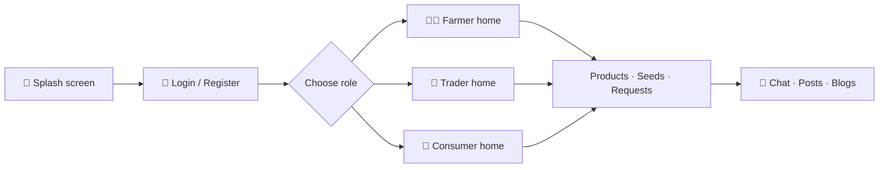

<div align="center">

  

  # AgroBuddy

  ### 🌱 One community for the people who grow, trade, and enjoy food

  An agriculture-focused Android application connecting **farmers**, **traders**, and **consumers** through products, knowledge, requests, and conversations.

  <p>
    
    
    
    
    
  </p>

  <p>
    <a href="#-features">Features</a> •
    <a href="#-getting-started">Getting started</a> •
    <a href="#-development">Development</a> •
    <a href="#-security">Security</a>
  </p>

</div>

> [!NOTE]
> AgroBuddy is currently an Android/Gradle project. The Firebase configuration file is intentionally kept local and is not committed to Git.

## ✨ Features

| 👨‍🌾 For farmers | 🏪 For traders | 🛒 For consumers |
|---|---|---|
| Publish products and seeds | Discover available products | Browse agricultural listings |
| Manage incoming requests | Request seeds and products | Submit product requests |
| Share farming knowledge | Chat with other users | Read blogs and community posts |
| Access crop disease assistance | Maintain a user profile | Connect with the agriculture community |

### Community and smart tools

<table>
  <tr>
    <td>🔐 <strong>Authentication</strong><br />Firebase sign-in with OTP verification.</td>
    <td>💬 <strong>Messaging</strong><br />Direct chat between community members.</td>
    <td>📰 <strong>Content</strong><br />Posts, comments, blogs, and news.</td>
  </tr>
  <tr>
    <td>📍 <strong>Location</strong><br />Location-aware agriculture workflows.</td>
    <td>📷 <strong>Media</strong><br />Camera and image upload support.</td>
    <td>🩺 <strong>Plant health</strong><br />TensorFlow Lite disease assistance.</td>
  </tr>
</table>

## 🧭 App flow



## 🧰 Technology stack

| Area | Tools |
|---|---|
| Platform | Android |
| Language | Java |
| UI | XML layouts, AndroidX, Material Components, RecyclerView |
| Backend | Firebase Authentication, Cloud Firestore, Firebase Storage, Firebase Analytics |
| Machine learning | TensorFlow Lite |
| Python integration | Chaquopy with Python 3.10 |
| Build | Gradle and Android Gradle Plugin |

## 📁 Project structure

```text
.
├── app/
│   ├── src/main/java/com/example/Farmer/   # Activities, fragments, models, adapters
│   ├── src/main/res/                       # Layouts, drawables, themes, and assets
│   ├── src/main/python/                    # Python utilities
│   ├── build.gradle
│   └── google-services.json                # Local Firebase configuration
├── gradle/
├── build.gradle
├── gradle.properties
├── settings.gradle
├── gradlew
└── gradlew.bat
```

## 🚀 Getting started

### Prerequisites

| Requirement | Version |
|---|---|
| Android Studio | Hedgehog or newer |
| Android SDK | 34 |
| JDK | 8 or compatible Android Studio JDK |
| Python | 3.10 |
| Firebase | Android project with Auth, Firestore, and Storage enabled |

### Installation

1. Open the project in Android Studio.
2. Create or select a Firebase project.
3. Enable **Firebase Authentication**, **Cloud Firestore**, and **Firebase Storage**.
4. Download the Firebase Android configuration file.
5. Place it at:

   ```text
   app/google-services.json
   ```

6. Sync Gradle, select an emulator or device, and run the `app` configuration.

<details>
<summary>🛠️ Build from the command line</summary>

**macOS/Linux**

```bash
./gradlew assembleDebug
```

**Windows**

```bat
gradlew.bat assembleDebug
```

The debug APK is written to `app/build/outputs/apk/debug/`.

</details>

## 🧪 Development

Run unit tests:

```bash
./gradlew test
```

Run connected Android tests with an emulator or physical device:

```bash
./gradlew connectedAndroidTest
```

<details>
<summary>🔒 Required Android permissions</summary>

Depending on the workflow, AgroBuddy may request:

- Internet access
- Camera access
- Fine and coarse location
- Image/media access

Grant permissions only when the related feature needs them.

</details>

## 🔐 Security

- Never commit `google-services.json`, signing keys, passwords, API keys, or local configuration.
- Configure and review Firebase security rules before using production data.
- Use a separate Firebase project for development and testing.

## 📄 License

No license has been specified yet. Add a license before distributing AgroBuddy or accepting external contributions.

<div align="center">

  <sub>Built with 🌾 for a more connected agriculture community.</sub>

</div>
